# SimpleRemoteKVM — Controle Mútuo de Mouse e Teclado via LAN (P2P Simétrico)

Aplicativo moderno em C# com **interface gráfica (Windows Forms Dark Theme)** e **arquitetura P2P simétrica e mútua**, idêntica ao modelo operacional do **Microsoft Garage Mouse without Borders**.

---

## 1. Conexão Mútua (Peer-to-Peer Simétrico)

No Mouse without Borders original (confirmado pela análise de engenharia reversa via REA):
- **Não existe distinção de "PC Servidor" vs "PC Cliente"**: todos os computadores executam exatamente o mesmo motor P2P.
- Ao abrir o aplicativo, **ambos os PCs iniciam seus serviços de escuta locais automaticamente** na porta 15200.
- Para vincular duas máquinas, **basta que QUALQUER UM dos dois PCs digite o IP do outro e clique em "Conectar"** (ou ambos conectem).
- Uma vez estabelecido o canal TCP full-duplex:
  - **O PC 1 pode controlar o PC 2** (pressionando `[ScrollLock]` no teclado do PC 1).
  - **O PC 2 pode controlar o PC 1** (pressionando `[ScrollLock]` no teclado do PC 2).
  - O pacote `PackageType.machineswitched` (ID 77, extraído do MWB) sincroniza o estado entre as duas telas em tempo real!

```mermaid
sequenceDiagram
    autonumber
    participant PC_A as PC A (Nó P2P 192.168.100.252)
    participant Socket as Canal TCP Bidirecional (Porta 15200)
    participant PC_B as PC B (Nó P2P 192.168.100.X)

    Note over PC_A,PC_B: Ambos iniciam ouvindo em 15200.<br/>Basta QUALQUER UM clicar em Conectar!
    PC_A->>Socket: Estabelece link TCP P2P com PC_B
    Socket->>PC_B: Handshake P2P confirmado!

    rect rgb(20, 45, 65)
        Note over PC_A: Usuário no PC A pressiona [ScrollLock]
        PC_A->>PC_B: machineswitched (77) -> PC A no controle
        PC_A->>PC_B: Stream de mouse (123) e teclado (122)
        Note over PC_B: PC B executa comandos via SendInput
    end

    rect rgb(50, 35, 20)
        Note over PC_B: Usuário no PC B pressiona [ScrollLock]
        PC_B->>PC_A: machineswitched (77) -> PC B no controle
        PC_B->>PC_A: Stream de mouse (123) e teclado (122)
        Note over PC_A: PC A executa comandos via SendInput
    end
```

---

## 2. Como Usar (Passo a Passo Mútuo)

Copie o executável [`SimpleRemoteKVM.exe`](SimpleRemoteKVM.exe) para os dois computadores.

### Passo 1: Abra o aplicativo nos dois computadores
1. Dê dois cliques em `SimpleRemoteKVM.exe` no **PC A** e no **PC B**.
2. Ambos já iniciam prontos, ouvindo conexões na porta 15200.
3. No topo de cada tela você verá o IP daquela máquina:
   - PC A mostra: `Meu IP na LAN: 192.168.100.252`
   - PC B mostra: `Meu IP na LAN: 192.168.100.50` *(exemplo)*

### Passo 2: Conecte (em qualquer um dos dois!)
- No **PC A**, no campo *"IP do Outro PC"*, digite o IP do PC B (ex: `192.168.100.50`) e clique em **"Conectar ao PC"**.
- *(Você NÃO precisa fazer nada no PC B! Ele aceitará o vínculo automaticamente).*
- Ambos os computadores exibirão a barra verde: **`● Conectado em modo P2P`**.

### Passo 3: Controle Mútuo em Tempo Real
- **Se você estiver sentado no PC A**: aperte **`[ScrollLock]`** -> O banner do PC A fica azul ciano (*Você está controlando o outro PC*) e o banner do PC B fica âmbar (*Este PC está sendo controlado remotamente*). O seu mouse do PC A agora controla o PC B!
- **Se você for para o PC B**: aperte **`[ScrollLock]`** no PC B -> Agora é o mouse e teclado do PC B que controlam o PC A!
- Aperte **`[ScrollLock]`** novamente a qualquer momento para voltar ao modo local.

---

## 3. Código-Fonte

- [`MainForm.cs`](MainForm.cs): Interface gráfica P2P simétrica com alternância mútua de controle.
- [`InputHookManager.cs`](InputHookManager.cs): Hooks globais com suporte ao pacote `machineswitched` (77).
- [`InputInjector.cs`](InputInjector.cs): Injeção via `SendInput` com array circular de descarte de duplicatas.
- [`NetworkPeer.cs`](NetworkPeer.cs): Nó P2P full-duplex na porta 15200 com buffer de 1 MB e `NoDelay = true`.
- [`Protocol.cs`](Protocol.cs): Struct `DATA` (37 bytes) e enum `PackageType`.
- [`build.bat`](build.bat): Compilador via `csc.exe /target:winexe`.
