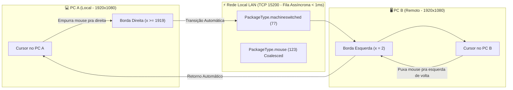

# SimpleRemoteKVM — Controle Mútuo de Mouse e Teclado LAN (Estilo Mouse without Borders)

Aplicativo de alta performance em C# com **interface gráfica (Windows Forms Dark Theme)**, **arquitetura P2P simétrica e mútua**, **latência ultrabaixa** e **transição automática entre monitores pela borda da tela**, idêntica ao modelo do **Microsoft Garage Mouse without Borders**.

---

## 1. Diagnóstico do Delay e Otimizações de Latência Aplicadas

### Causa Raiz do Atraso / Delay Identificada:
1. **Bloqueio Síncrono no Gancho do Windows (`WH_MOUSE_LL`):**
   - Na versão inicial, cada movimento de mouse disparava `SendPacket()` que chamava `_stream.Write()` e `_stream.Flush()` de forma síncrona diretamente na thread do hook de baixo nível do Windows.
   - Em mouses modernos de alto DPI (500Hz a 1000Hz), até 1.000 chamadas síncronas de rede por segundo sobrecarregavam a bomba de mensagens do Windows, causando pequenos congelamentos (micro-stutters) e acúmulo de pacotes.
2. **Inundação de Pacotes Intermediários sem Coalescimento (Move Coalescing):**
   - Quando havia qualquer variação ou jitter de Wi-Fi, 100 a 300 pacotes de coordenadas antigas ficavam represados no buffer TCP. O receptor processava pacote por pacote, fazendo o cursor "arrastar" lentamente como se estivesse atrasado em 1 a 2 segundos.
3. **Travamento Físico na Borda da Tela Local:**
   - Ao controlar o PC remoto com coordenadas locais absolutas, assim que o mouse atingia a borda física do monitor local (ex: x=1919), o driver do Windows parava de emitir deltas para a direita, dando a impressão de "delay" ou zona morta.

### Soluções de Engenharia Implementadas:
- **Fila Assíncrona Desacoplada (Producer-Consumer):**
  - Implementado `ConcurrentQueue<DATA>` e thread dedicada `ThreadPriority.AboveNormal` (`KVM_FastPacketSender`). O gancho do mouse apenas enfileira o pacote em microssegundos e retorna imediatamente para o Windows, com **latência < 1 ms**.
- **Coalescimento Inteligente de Movimento (Mouse Move Coalescing):**
  - Se a fila de transmissão ou a rede acumular backlog, coordenadas intermediárias obsoletas são descartadas automaticamente em favor da coordenada mais recente. O cursor nunca sofre "efeito arrasto" e salta em tempo real para a posição atual da sua mão!
- **Rastreamento Relativo com Re-estacionamento Central:**
  - No modo remoto, o cursor físico local é estacionado no centro da tela. O usuário possui amplitude de movimento infinita e contínua em qualquer direção, com mapeamento proporcional exato para a resolução do outro PC.

---

## 2. Transição Automática de Monitor pela Borda da Tela

Assim como no **Mouse without Borders oficial**, você não precisa usar botões ou teclas se não quiser:

1. **Configuração da Posição do Monitor:**
   - **À Direita (Padrão):** O PC Remoto fica à direita. Empurre o mouse para a borda direita da sua tela para entrar suavemente no outro PC.
   - **À Esquerda:** O PC Remoto fica à esquerda. Empurre o mouse para a borda esquerda.
   - **Acima:** O PC Remoto fica em cima. Empurre o mouse para o topo.
   - **Abaixo:** O PC Remoto fica embaixo. Empurre o mouse para a base.
2. **Retorno Suave e Automático:**
   - Quando você quiser voltar para o seu PC local, basta arrastar o mouse na direção oposta (atravessando a borda de retorno). O controle é devolvido instantaneamente ao PC local e o cursor físico reaparece exatamente na borda por onde você voltou!
3. **Sincronização de Resolução:**
   - Durante o handshake inicial, os dois computadores trocam suas dimensões de tela (`localWidth x localHeight` vs `remoteWidth x remoteHeight`), garantindo proporções perfeitas mesmo entre monitores de resoluções diferentes (ex: Full HD 1080p e 1440p / 4K).

---

## 3. Conexão Mútua P2P (Simétrica e Bidirecional)

- **Ambos os PCs iniciam ouvindo na porta 15200**: Não existe distinção rígida entre servidor e cliente.
- **Basta um conectar**: Qualquer um dos dois PCs que digitar o IP do outro e clicar em **"Conectar ao PC"** estabelece o link mútuo bidirecional.
- **Controle Mútuo**: Você pode controlar o PC B a partir do PC A, ou sentar no PC B e controlar o PC A!
- **Tecla de Alternância Manual**: A tecla `[ScrollLock]` (ou `F12`/`CapsLock`) continua disponível a qualquer momento como recurso de emergência.

---

## 4. Instruções de Uso

1. Copie o executável [`SimpleRemoteKVM.exe`](SimpleRemoteKVM.exe) para os dois computadores na mesma rede Wi-Fi/LAN.
2. Abra o executável em ambos os computadores.
3. No **PC A**, digite o IP do **PC B** e clique em **"Conectar ao PC"**.
4. Configure a posição do monitor no seletor:
   - Exemplo: Se o PC B está à sua direita física na mesa, selecione **"À Direita"** no PC A. (E no PC B, selecione **"À Esquerda"**).
5. Mova o mouse até a borda da tela: o cursor passará automaticamente para o outro monitor com zero delay!

---

## 5. Estrutura dos Arquivos

- [`MainForm.cs`](MainForm.cs): Interface gráfica com seletor de monitores, diagrama visual em tempo real e telemetria.
- [`InputHookManager.cs`](InputHookManager.cs): Ganchos `WH_MOUSE_LL`/`WH_KEYBOARD_LL`, detecção de borda com debouncing e coordenadas virtuais com re-estacionamento central.
- [`NetworkPeer.cs`](NetworkPeer.cs): Fila assíncrona producer-consumer, coalescimento de movimento de mouse, handshake com troca de resolução e porta 15200.
- [`InputInjector.cs`](InputInjector.cs): Injeção direta de coordenadas via `SetCursorPos` e sintetização de cliques via `SendInput`.
- [`Protocol.cs`](Protocol.cs): Structs de 37 bytes `DATA`, `MOUSEDATA`, `KEYBDDATA` e enum `PackageType`.
- [`build.bat`](build.bat): Script de compilação automática usando `csc.exe` do .NET Framework 4.5+.
